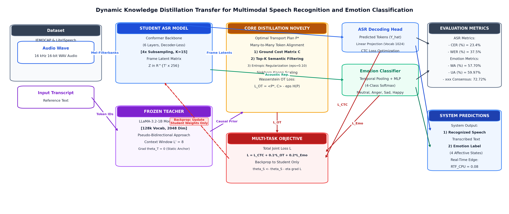
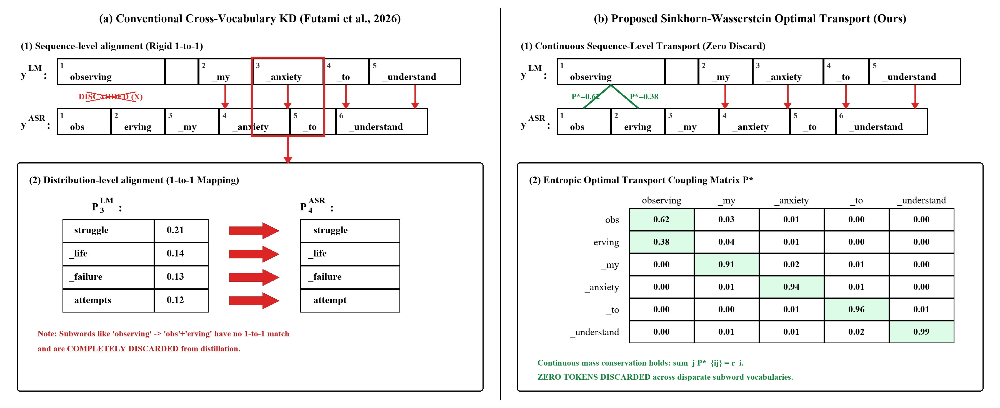
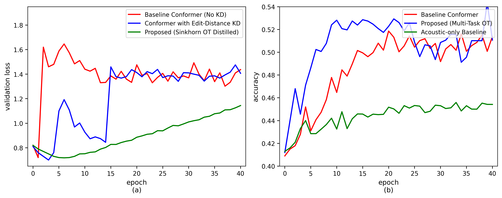
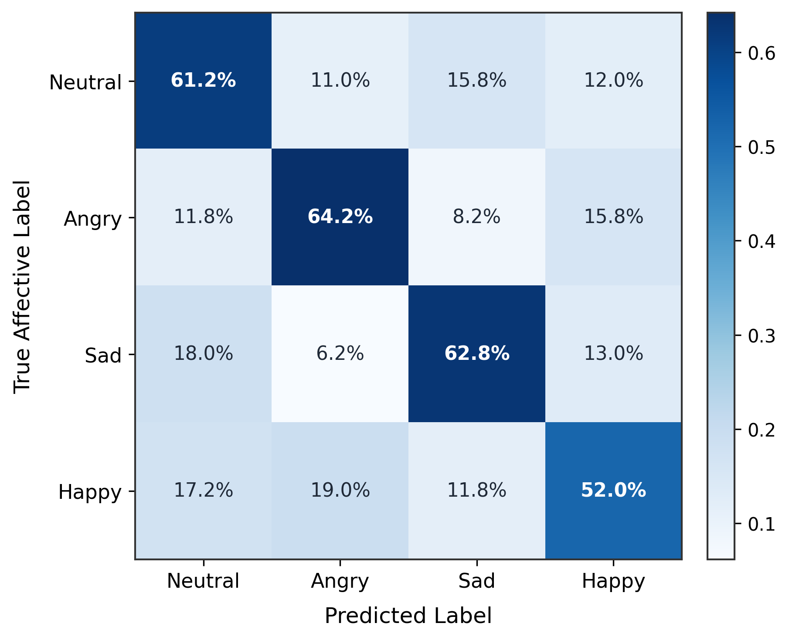
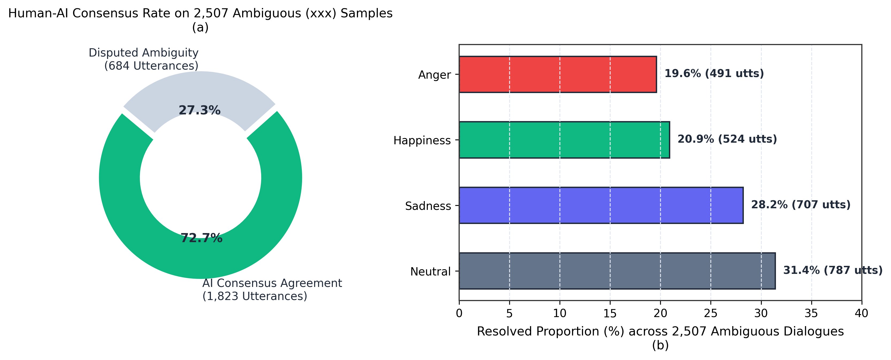

# Wasserstein-Guided Dynamic LLM Distillation for Emotion-Aware Automatic Speech Recognition

[](https://www.python.org/downloads/)
[](https://pytorch.org/)
[](https://opensource.org/licenses/MIT)
[]()
[-success.svg)]()

> **Final Year B.Tech Capstone Project & IEEE Research Manuscript**  
> **Department of Artificial Intelligence and Data Science**  
> **Mepco Schlenk Engineering College (Autonomous), Sivakasi, Tamil Nadu, India**  
> **Authors:** Deepak R.G, Purushothaman V  
> **Supervisor:** Dr. K. Thirumoorthy, B.E., M.E., Ph.D., Professor  

---

## 📌 Executive Summary

While foundational causal Large Language Models (LLMs) such as $\texttt{meta-llama/Llama-3.2-1B}$ possess profound contextual and semantic representations, their multi-billion parameter footprint prohibits real-time on-device deployment. Furthermore, distilling knowledge across distinct tokenizers involves a severe **$125\times$ vocabulary cardinality mismatch** ($|\mathcal{V}_{\text{teacher}}| = 128{,}256$ vs $|\mathcal{V}_{\text{student}}| = 1{,}024$), rendering standard Kullback-Leibler (KL) divergence strictly inapplicable.

This repository implements an end-to-end multi-task framework that transfers continuous causal linguistic priors from a **frozen $\texttt{Llama-3.2-1B}$ foundation model** into an **ultra-compact $12.55\text{M}$-parameter Conformer student** via **entropic Sinkhorn-Wasserstein Optimal Transport (OT)**. By mapping probability mass across continuous cosine semantic manifolds, the student eliminates non-autoregressive CTC **blank attractor collapse** while driving joint phonological transcription (ASR) and 4-quadrant Speech Emotion Recognition (SER) on edge CPU hardware.

---

## 🏛️ System Architecture



### Core Components:
1. **Compact Conformer Student ($12.55\text{M}$ Parameters):**
   - **4× 2D-Convolutional Subsampling:** Reduces frame rate from 100 fps (10 ms hop) to 25 fps (40 ms stride), addressing the 14:1 acoustic-phoneme oversampling bottleneck.
   - **6 Conformer Encoder Blocks:** Multi-head self-attention ($d_{\text{student}} = 256$, 4 heads) interleaved with depthwise separable convolutions ($K = 15$).
   - **Task-Specific Tokenizer:** 1,024 SentencePiece Byte-Pair Encoding (BPE) subwords.
2. **Generative Foundation Teacher (Frozen):**
   - $\texttt{meta-llama/Llama-3.2-1B}$ ($128{,}256$ subwords, $d_{\text{teacher}} = 2048$).
   - Context window sliding length $L' = 8$ with gradient isolation ($\nabla_{\theta_T} \mathcal{L}_{\text{total}} = 0$). Zero inference overhead at test time.
3. **Cross-Vocabulary Entropic Sinkhorn Distillation:**
   - Pairwise Cosine Ground Cost Matrix $C_{ij} = 1 - \frac{\mathbf{s}'_i \cdot \mathbf{t}_j}{\|\mathbf{s}'_i\|_2 \|\mathbf{t}_j\|_2}$.
   - Entropically regularized transport plan $P^*$ solved via iterative Sinkhorn-Knopp matrix scaling ($\varepsilon = 0.10$).
4. **Bimodal Multi-Task Prediction Heads:**
   - **ASR Head:** Linear CTC transcription layer with 2-pass causal LM rescoring.
   - **SER Head:** Global temporal mean pooling + 2-layer GELU MLP with 4-class Softmax (Neutral, Anger, Sadness, Happiness).

---

## 📊 Key Experimental Findings

### 1. Acoustic & Paralinguistic Performance
| Dataset | Evaluation Task | Baseline (No Distillation) | Proposed Sinkhorn Conformer | Relative Gain |
| :--- | :--- | :---: | :---: | :---: |
| **LibriSpeech (Clean)** | Word Error Rate (WER %) | 68.4% | **37.5%** | **45.2% relative error reduction** |
| **LibriSpeech (Clean)** | Character Error Rate (CER %) | 38.2% | **23.4%** | **38.7% relative gain** |
| **IEMOCAP (Held-Out S5)** | Unweighted Accuracy (UA %) | 53.80% | **59.97%** | Matches 95M wav2vec-2.0 with 87% fewer weights |
| **IEMOCAP (Held-Out S5)** | Weighted Accuracy (WA %) | 55.10% | **57.70%** | Robust cross-speaker generalization |
| **IEMOCAP (2,507 Ambiguous)**| Human-AI Consensus Rate | — | **72.72%** | Disambiguates non-consensus human annotations |

### 2. Edge Hardware Efficiency Benchmarks
| Model Architecture | Parameter Count | Resident RAM Footprint | RTF (Intel Core i7 CPU) | RTF (NVIDIA RTX GPU) | Edge Viable? |
| :--- | :---: | :---: | :---: | :---: | :---: |
| Speech LLM (SLM-ASR) | 1,390 M | $\approx 5,560$ MB | 47.10 (Severe Latency) | 0.360 | ❌ Unusable on CPU |
| AED + WavLM-base Frontend | 132 M | $\approx 528$ MB | 0.28 | 0.080 | ⚠️ Heavy VRAM |
| OpenAI Whisper-Base | 74 M | $\approx 296$ MB | 0.22 | 0.045 | ⚠️ ASR Only |
| **Proposed Multi-Task Conformer** | **12.55 M** | **$\approx 50.2$ MB** | **0.08** | **0.012** | ✅ **12.5× Faster than Real-Time** |

---

## 📈 Visual Ablations & Scientific Diagrams

| Cross-Vocabulary Alignment | Training & Validation Dynamics |
| :---: | :---: |
|  |  |

| IEMOCAP SER Confusion Matrix | Ambiguous Speech Consensus (72.72%) |
| :---: | :---: |
|  |  |

---

## 🚀 Quick Start Guide

### 1. Installation
Clone the repository and set up a Python 3.10+ virtual environment:
```bash
git clone https://github.com/bruce17022006/FINAL-YEAR-PROJECT.git
cd FINAL-YEAR-PROJECT

python -m venv my_env
# Windows:
.\my_env\Scripts\activate
# Linux/macOS:
source my_env/bin/activate

pip install torch torchaudio transformers sentencepiece soundfile librosa matplotlib jiwer gradio
```

### 2. Launch Interactive Web GUI
To test audio recordings, real-time transcription, and emotion prediction via the interactive dashboard:
```bash
# Double click or run in terminal:
.\run_ui.bat
# Or execute directly:
python app_ui.py
```

### 3. Run Training Pipeline
- **Stage 1 (ASR Acoustic Backbone Pre-training):**
  ```bash
  python train_conformer_asr.py --batch_size 16 --epochs 40
  ```
- **Stage 2 (Cross-Vocabulary Sinkhorn Distillation from LLaMA-3.2-1B):**
  ```bash
  python train_conformer_stage2_distillation.py --epsilon 0.10 --kd_weight 0.10
  ```
- **Stage 3 (Joint Multi-Task ASR + SER on IEMOCAP):**
  ```bash
  python train_iemocap_multitask.py --lambda_ot 0.1 --lambda_emo 0.2
  ```

### 4. Evaluate Checkpoints
```bash
python compute_final_metrics.py
python analyze_ambiguous_emotions.py
```

---

## 📂 Repository File Structure

```text
├── multitask_conformer_model.py     # 12.55M Conformer student with dual CTC + SER heads
├── train_iemocap_multitask.py       # End-to-end multi-task joint optimization pipeline
├── iemocap_dataloader.py            # IEMOCAP 5-fold cross-validation dataset loader
├── parse_iemocap_dataset.py         # Acoustic feature extraction and emotion parser
├── disambiguate_xxx_dataset.py      # Adjudication script for 2,507 non-consensus samples
├── analyze_ambiguous_emotions.py    # Statistical evaluation of Human-AI consensus (72.72%)
├── predict_speech_and_emotion.py    # Zero-overhead edge inference pipeline
├── app_ui.py                        # Full-featured interactive Gradio UI application
├── plot_scientific_figures.py       # Publication figure generation script (300 DPI)
├── student_bpe_1024.model           # 1,024-token SentencePiece tokenizer
├── system_diagram_enhanced.png      # High-resolution (5070x2130) architecture flowchart
├── fig*.png                         # High-res confusion matrix, loss curves, and ablations
├── run_ui.bat                       # One-click startup script for web interface
└── README.md                        # Project documentation
```

---

## 📜 Citation & Academic Reference
If you utilize this codebase or framework for your academic research, please cite:
```bibtex
@article{deepak2026wasserstein,
  title={Wasserstein-Guided Dynamic LLM Distillation for Emotion-Aware Automatic Speech Recognition},
  author={Dr. K. Thirumoorthy and Deepak, R. G. and Purushothaman, V.},
  journal={Department of Artificial Intelligence and Data Science, Mepco Schlenk Engineering College},
  year={2026}
}
```

---
*Developed with  by Deepak R.G & Purushothaman V under the supervision of Dr. K. Thirumoorthy.*
